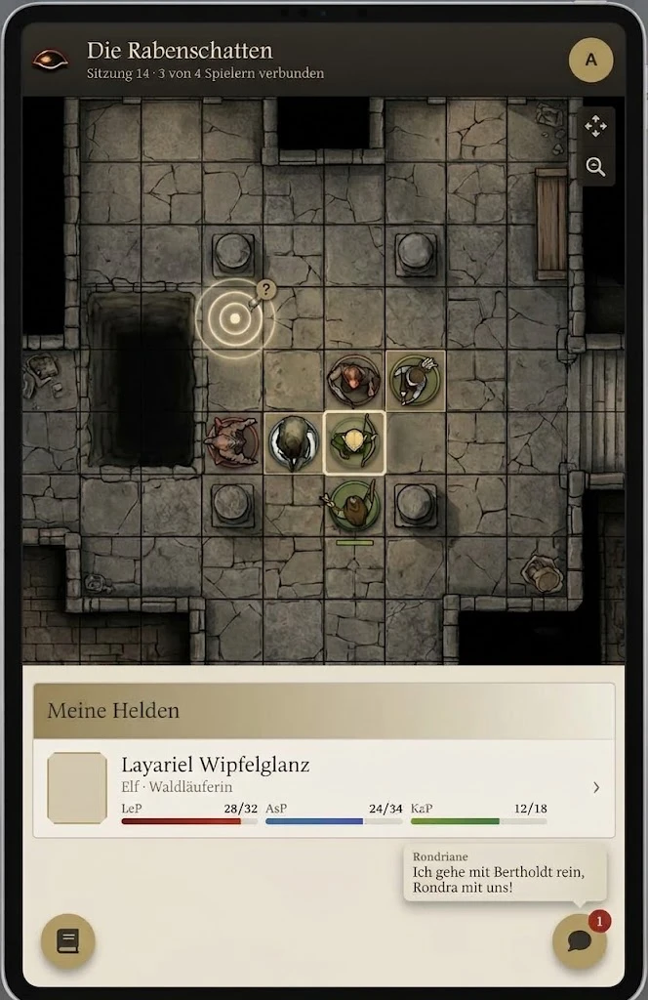

# Rückmeldung zum Mobil-Click-Dummy

Stand: 14.10.2026 · Von: Lyynix · Gegenstand: `clickdummy/design_handoff_mobile/` (Stand `1d731d5`) und [MOBILE.md](../MOBILE.md)

## Gesamteindruck

Grundsätzlich gelungen, viele Funktionen sind schon da. Der wichtigste Punkt ist die fehlende Szene: Ohne sie fehlt am Tablet ein großer Teil des Spiels. Die übrigen Punkte sind Ergänzungen an Chat, Journal und SL-Ansicht sowie eine Vereinfachung beim Start.

## 1. Szene anzeigen (wichtigster Punkt)

Es sollte möglich sein, die Szene zu sehen und minimal mit ihr zu interagieren, mindestens auf dem Tablet. Das weicht bewusst von MOBILE.md (ohne Canvas, **E18**) und der Handoff-Entscheidung „Spielfeld: keine Karte“ ab.

**Vorschlag für den Aufbau** (Startseite des Spielers umstrukturieren, bisher Kacheln Held / Chat / Journal):

- Oben die Szene als Canvas, mit Fingergesten verschieben und zoomen.
- Darunter der eigene Held (bzw. die eigenen Helden).
- Journal und Chat als schwebende Knöpfe (Floating Action Buttons) in den unteren Ecken.
- Der Chat zeigt neue Nachrichten als Sprechblase über seinem Knopf, mit kleiner Zahl für ungelesene — wie Foundry es bei eingeklappter Seitenleiste ohnehin macht.

**Interaktion mit der Szene:**

- Langes Drücken auf die Karte: pingen.
- Langes Drücken auf den eigenen Token und ziehen: Token verschieben.

*Mockup mit KI erstellt, zeigt nur die Anordnung.*

**Falls es doch ohne Szene bleiben soll:** Dann sollte man gleichzeitig am PC und am Handy mit demselben Benutzer angemeldet sein können (am PC die Szene, am Handy der Bogen). Wie das in Foundry geht, ist noch zu recherchieren.

## 2. Chat: Schicksalspunkte einsetzen

Im Chat fehlt eine Möglichkeit, Schicksalspunkte einzusetzen (z. B. neu würfeln). Vorschlag: Tippen oder langes Drücken auf einen Wurf bzw. einzelnen Würfel öffnet die Auswahl — als Ersatz für das Kontextmenü des Systems am Desktop.

## 3. Journal: Ordner beibehalten

Journale sollten in ihren Ordnern bleiben, so wie Foundry sie auch am Desktop zeigt, statt einer flachen Liste.

## 4. SL: Proben anfordern

Für die Spielleitung wäre ein Weg gut, Proben anzufordern. Das System bringt dafür schon den `RollRequestService` mit (Anfrage-Karte im Chat, die Talent-Vorschläge auf `feature/skill-suggestions` werten sie bereits aus).

## 5. Oberfläche automatisch nach Bildschirmbreite wählen

Zur Auswahl nach dem Login (MOBILE.md, Abschnitt 4 mit den drei Kacheln, **E16**): Das sollte automatisch anhand der Bildschirmbreite erkannt werden. Eine Auswahl bei jedem Start ist zu umständlich.

## Betroffene Entscheidungen in MOBILE.md

| Entscheidung | Bisher | Laut Rückmeldung |
|---|---|---|
| E18 Spielfeld | Kein Canvas in v1 | Szene mit Pingen und Token-Verschieben, mindestens am Tablet |
| Startseite der Shell (Abschnitt 6 / Handoff) | Kacheln Held, Chat, Journal | Szene oben, Held darunter, Chat und Journal als schwebende Knöpfe |
| Abschnitt 4 / E16 Auswahl nach dem Login | Drei Kacheln, Vorauswahl nach Gerät | Automatisch nach Bildschirmbreite, ohne Abfrage |
| E2 SL auf Mobilgerät | Keine SL-Mobilansicht (Handoff zeigt schon eine) | SL-Ansicht mit „Proben anfordern“ |
